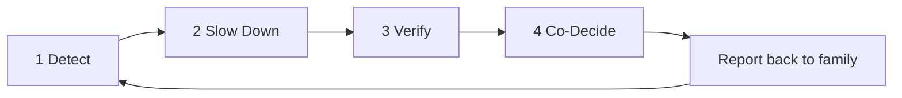
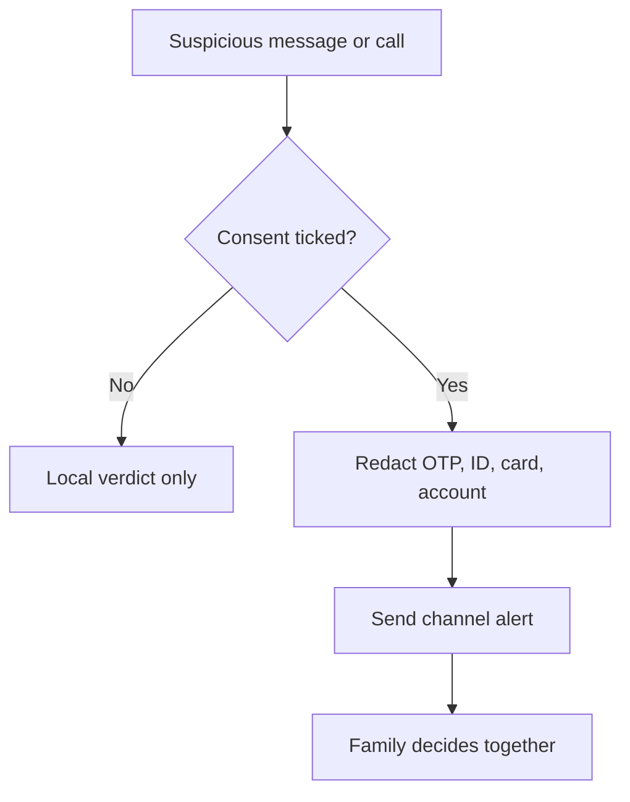
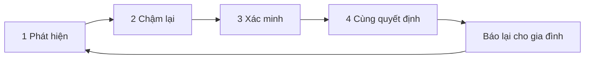
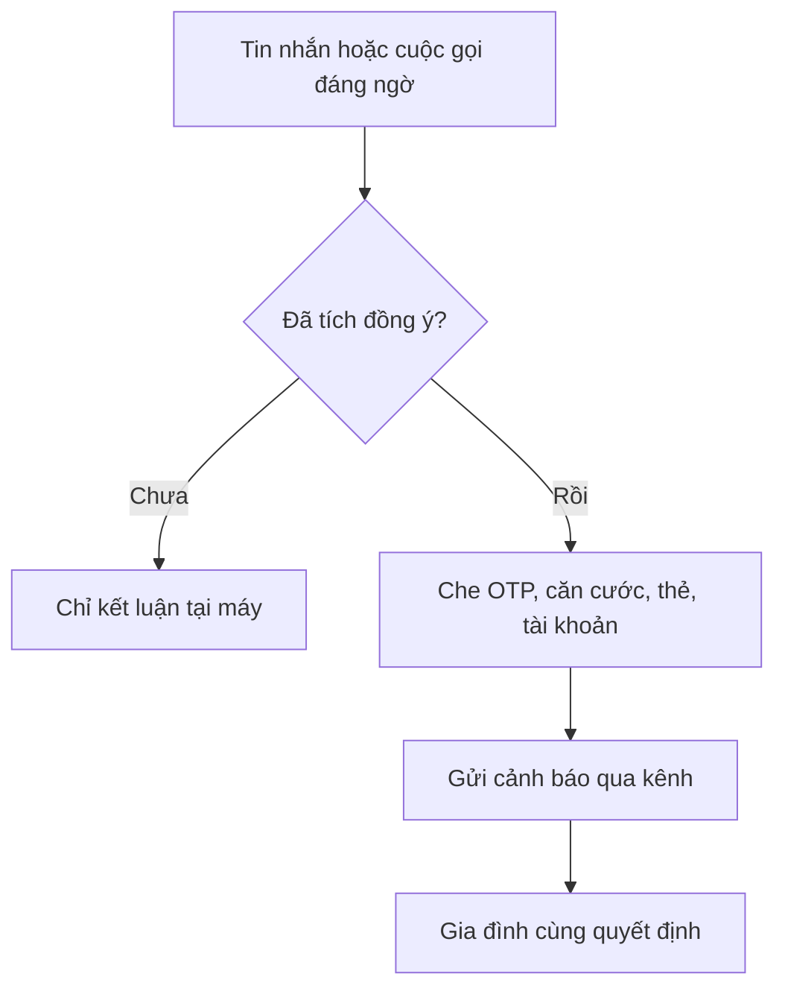

# ScamKill Guidebook / Sổ tay ScamKill

A bilingual user and judge guide for the ScamKill demo.
Hướng dẫn song ngữ dành cho người dùng và giám khảo của bản demo ScamKill.

- Default language: English (`en`).
- Ngôn ngữ mặc định: Tiếng Anh (`en`).
- Switch language in one tap with the `EN` / `VN` pill in the header.
- Đổi ngôn ngữ bằng một chạm với nút `EN` / `VN` trên thanh tiêu đề.
- Open this guide from any screen with the `📖 Guide` / `📖 Hướng dẫn` pill.
- Mở hướng dẫn này từ mọi màn hình bằng nút `📖 Guide` / `📖 Hướng dẫn`.

---

## English

### 1. What ScamKill does

ScamKill is a family scam shield with three jobs:

1. **Call Shield**: warn before a suspicious call turns into a transfer.
2. **Message Check**: read a suspicious SMS, Zalo, or chat message and return a plain-language risk verdict.
3. **Family Alert**: route one consent-gated alert to the people who can help.

The app never claims certainty. It gives a risk level, a short reason list, and a next step.

### 2. The 4-step loop



| Step | What the person sees | What it does |
|---|---|---|
| Detect | Risk badge, phone number, at most 3 reasons | Names the pattern without panic language |
| Slow Down | 4 second breathing reset and a hold on the action | Breaks the urgency spell before money moves |
| Verify | Callback prompt and family code prompt | Moves the decision to a trusted channel |
| Co-Decide | One family alert with a consent gate | Shares the decision, not the private data |

#### Why this loop

- **Amygdala hijack interruption.** Urgency, threats, and authority claims push the brain into threat mode. In threat mode, people act fast and check less. ScamKill inserts a stop between the trigger and the action.
- **4 second physiological reset.** A slow exhale activates the parasympathetic branch of the nervous system. Four seconds in and four seconds out lowers arousal enough to read a warning and think again.
- **Miller's Law, 3 chunk cap.** Working memory holds only a few items under stress. ScamKill caps the reason list at 3 short chunks so the message survives the moment.
- **Gollwitzer implementation intentions.** A pre-decided `if X, then Y` plan fires under pressure. ScamKill trains one: "If a caller asks for money or an OTP, then I hang up and call the saved number."
- **Epistemic humility.** The app says "unverified" when data is thin. Honest uncertainty beats a confident wrong answer.

### 3. The annotated screen

```text
┌──────────────────────────────────────────────┐
│ ScamKill                        📖 Guide  ⑤  │
├──────────────────────────────────────────────┤
│ ①  ⚠ HIGH RISK   +855 92 111 2233            │
│    Fake police. 4 calls in 3 minutes.        │
│                                              │
│    • Threatens an arrest warrant             │
│    • Foreign prefix +855                     │
│    • Asks for an urgent transfer             │
│                                              │
│ ②  🍃 Breathe in 4s, out 4s      Slow down   │
│                                              │
│ ③ [ Call saved ]       ④ [ Tell family ]     │
├──────────────────────────────────────────────┤
│  Call  Messages  Family  Alerts  Settings    │
└──────────────────────────────────────────────┘
```

| Callout | Name | What to inspect |
|---|---|---|
| ① | Verdict shield | Risk badge, phone number, one plain sentence, no certainty claim |
| ② | 4 second reset | Breathing cue and the Slow down action |
| ③ | Verify callback | Call the saved contact number, not the incoming number |
| ④ | Co-decide | One family alert, consent decides what content travels |
| ⑤ | Guide pill | Reopen this map from any screen in one tap |

The interactive version puts the same five callouts over a live miniature of the screen. Tap a circle to zoom into that exact region.

### 4. Guide for older adults

Three rules, one at a time:

1. **Stop and hold.** No transfer, no OTP, no card photo. A real bank never asks for these.
2. **Breathe 4 and 4.** Breathe in for 4 seconds, out for 4 seconds. Press Slow down and let the call wait.
3. **Ask the family code.** Only trust a caller who says the family code. If they cannot, hang up and call your child.

Use the `A+` pill to enlarge text and the contrast pill to switch to a high contrast palette.

### 5. Guide for adult children

Setup checklist:

1. **Set the family code.** Open `Family & Bot`, then the `Family code card`. Pick two short words only the family knows. Never post the word online.
2. **Link the channels.** Turn on Telegram, Zalo, and SMS as needed. Telegram needs the bot chat ID. Tick the PDPD 2025 consent before any message content is shared.
3. **Install the home screen icon.** Android Chrome: menu, then `Add to Home screen`. iPhone Safari: `Share`, then `Add to Home Screen`. The icon opens full screen like a normal app.
4. **Rehearse monthly.** Run the Mrs. Lan scenario together. Confirm that the alert reaches every channel in under 10 seconds.

Switching a channel off stops future routing immediately.

### 6. Guide for competition judges

Verification protocol:

1. Open the Scenario Drawer (`Kịch bản Demo`) or this guide and run all 5 fixtures.
2. Check the verdict shape: one badge, at most 3 plain reasons, one epistemic note.
3. Check the privacy gates with consent both off and on.
4. Check that every verdict names the next loop step.

| Fixture id | Scenario | Expected badge | What to verify |
|---|---|---|---|
| `ba-lan-30m` | Mrs. Lan 30M Call | Caution | Unknown number claims to be the daughter. Callback and family code prompts appear |
| `fake-police-call` | Fake Police +855 | High risk | Foreign prefix, 4 burst calls, arrest threat, family alert fires |
| `unverified-number` | Unverified Number | Unverified | No data means unverified. The app does not guess |
| `fake-bank-otp-sms` | Bank OTP SMS | High risk | Fake domain is flagged and the OTP is redacted |
| `zalo-voice-clone` | Zalo Voice Clone | Caution | Secrecy plus urgency is treated as a warning pattern |

Replay rule: each fixture is a fixed input with a fixed expected output. Same input, same verdict, no network required.

### 7. PDPD 2025 privacy gates

1. **Consent first.** Message content is shared with family channels only after an explicit PDPD tick.
2. **Least data.** With consent off, an alert carries only the alert type, time, and phone number.
3. **Redaction.** OTP codes, ID numbers, card numbers, and bank accounts are masked before analysis.
4. **Withdrawal.** Turning a channel off stops future routing immediately.
5. **No overclaim.** Verdicts state risk, never certainty. Unverified is a first class answer.
6. **Audit trail.** Alerts keep channel, timestamp, and delivery status. Content appears only when consent is on.



### 8. Zoom and focus controls

| Control | Action |
|---|---|
| `1.0x` | Full map view |
| `1.4x` | Detail view |
| `1.8x` | Inspection view for small text |
| `Step 1..5` | Focus each annotated callout in order |
| Reset icon | Return to the centered full map |

Numbered circles ① to ⑤ also set focus and zoom in one tap. The camera uses a spring animation on native and a GSAP tween on web. Reduced motion is respected on both.

### 9. Accessibility

- `A+` cycles text size: 100%, 115%, 130%.
- Contrast control cycles warm light, calm dark, and high contrast yellow on black.
- Every control has a spoken accessibility label in the active language.
- Haptics confirm taps on supported devices.
- Web typography: Bricolage Grotesque for headings, Atkinson Hyperlegible for body text, Azeret Mono for numbers.
- The guide keeps one action per row and avoids timed reading tasks.

---

## Tiếng Việt

### 1. ScamKill làm gì

ScamKill là lá chắn chống lừa đảo cho gia đình, gồm ba việc:

1. **Lá chắn cuộc gọi**: cảnh báo trước khi một cuộc gọi đáng ngờ biến thành chuyển tiền.
2. **Kiểm tra tin nhắn**: đọc SMS, Zalo hoặc tin nhắn đáng ngờ và trả về kết luận rủi ro bằng lời dễ hiểu.
3. **Cảnh báo gia đình**: gửi một cảnh báo có kiểm soát đồng ý tới người có thể giúp.

Ứng dụng không bao giờ khẳng định chắc chắn. Ứng dụng đưa ra mức rủi ro, vài lý do ngắn và bước tiếp theo.

### 2. Vòng lặp 4 bước



| Bước | Người dùng thấy gì | Bước này làm gì |
|---|---|---|
| Phát hiện | Nhãn rủi ro, số điện thoại, tối đa 3 lý do | Gọi tên dấu hiệu, không gây hoảng |
| Chậm lại | Nhịp thở 4 giây và lệnh giữ hành động | Cắt cơn gấp gáp trước khi tiền rời tài khoản |
| Xác minh | Gợi ý gọi lại và hỏi mã gia đình | Đưa quyết định sang kênh tin cậy |
| Cùng quyết định | Một cảnh báo gia đình có cổng đồng ý | Chia sẻ quyết định, không chia sẻ dữ liệu riêng tư |

#### Vì sao dùng vòng lặp này

- **Cắt cơn bắt cóc hạch hạnh nhân.** Đe dọa và quyền uy đẩy não vào trạng thái báo động. Trong trạng thái đó, người ta làm nhanh và kiểm tra ít. ScamKill chèn một điểm dừng giữa cú huých và hành động.
- **Nhịp thở 4 giây.** Thở ra chậm kích hoạt nhánh đối giao cảm. Bốn giây vào và bốn giây ra hạ mức căng đủ để đọc cảnh báo và nghĩ lại.
- **Định luật Miller, tối đa 3 mẩu.** Trí nhớ làm việc chỉ giữ được vài mục khi căng thẳng. ScamKill giới hạn 3 lý do ngắn để thông điệp còn đọng lại.
- **Ý định hành động Gollwitzer.** Kế hoạch `nếu X thì Y` được quyết trước sẽ kích hoạt dưới áp lực. ScamKill luyện một câu: "Nếu người gọi đòi tiền hoặc mã OTP, thì mình tắt máy và gọi số đã lưu."
- **Khiêm tốn về dữ liệu.** Khi dữ liệu mỏng, ứng dụng nói "chưa xác minh". Thừa nhận chưa biết tốt hơn một câu trả lời sai đầy tự tin.

### 3. Bản đồ màn hình có chú thích

```text
┌──────────────────────────────────────────────┐
│ ScamKill                     📖 Hướng dẫn ⑤  │
├──────────────────────────────────────────────┤
│ ①  ⚠ NGUY CƠ CAO   +855 92 111 2233          │
│    Giả công an. 4 cuộc gọi trong 3 phút.     │
│                                              │
│    • Đe dọa lệnh bắt tạm giam                │
│    • Đầu số nước ngoài +855                  │
│    • Yêu cầu chuyển tiền gấp                 │
│                                              │
│ ②  🍃 Hít vào 4 giây, thở ra 4 giây          │
│                                              │
│ ③ [ Gọi số đã lưu ]  ④ [ Báo gia đình ]      │
├──────────────────────────────────────────────┤
│  Gọi  Tin nhắn  Gia đình  Cảnh báo  Cài đặt  │
└──────────────────────────────────────────────┘
```

| Chú thích | Tên | Cần kiểm tra gì |
|---|---|---|
| ① | Khiên kết luận | Nhãn rủi ro, số điện thoại, một câu dễ hiểu, không hứa chắc chắn |
| ② | Nhịp thở 4 giây | Gợi ý thở và nút Chậm lại |
| ③ | Gọi lại để xác minh | Gọi số đã lưu, không gọi lại số vừa gọi tới |
| ④ | Cùng quyết định | Một cảnh báo gia đình, sự đồng ý quyết định nội dung đi kèm |
| ⑤ | Nút Hướng dẫn | Mở lại bản đồ này từ mọi màn hình bằng một chạm |

Bản tương tác đặt năm chú thích này lên một màn hình thu nhỏ. Chạm vào vòng tròn số để phóng to đúng vùng đó.

### 4. Dành cho Bố Mẹ

Ba điều, đọc từng điều:

1. **Dừng lại, giữ nguyên.** Không chuyển tiền, không đọc mã OTP, không chụp ảnh thẻ. Ngân hàng thật không bao giờ hỏi những thứ này.
2. **Thở 4 và 4.** Hít vào 4 giây, thở ra 4 giây. Bấm Chậm lại và để cuộc gọi chờ.
3. **Hỏi mã gia đình.** Chỉ tin người gọi khi họ nói đúng mã gia đình. Nếu họ không nói được, tắt máy và gọi con.

Dùng nút `A+` để tăng cỡ chữ và nút độ tương phản để đổi bảng màu dễ nhìn.

### 5. Dành cho Con Cháu

Danh sách cài đặt:

1. **Đặt mã gia đình.** Mở `Gia đình & Bot`, rồi mở `Thẻ mã gia đình`. Chọn hai từ ngắn chỉ gia đình biết. Không đăng từ này lên mạng.
2. **Nối các kênh.** Bật Telegram, Zalo và SMS khi cần. Telegram cần chat ID của bot. Tích đồng ý PDPD 2025 trước khi chia sẻ nội dung tin nhắn.
3. **Cài ra màn hình chính.** Android Chrome: mở menu, rồi `Thêm vào màn hình chính`. iPhone Safari: `Chia sẻ`, rồi `Thêm vào Màn hình chính`. Biểu tượng mở toàn màn hình như ứng dụng thật.
4. **Diễn tập mỗi tháng.** Chạy kịch bản Bà Lan cùng nhau. Kiểm tra cảnh báo tới mọi kênh trong dưới 10 giây.

Tắt một kênh là dừng mọi lần gửi sau đó ngay lập tức.

### 6. Dành cho Giám khảo

Quy trình kiểm chứng:

1. Mở Kịch bản Demo hoặc hướng dẫn này và chạy đủ 5 kịch bản.
2. Kiểm tra cấu trúc kết luận: một nhãn, tối đa 3 lý do ngắn, một ghi chú về giới hạn dữ liệu.
3. Kiểm tra cổng riêng tư khi chưa đồng ý và khi đã đồng ý.
4. Kiểm tra mỗi kết luận có chỉ ra bước tiếp theo trong vòng lặp.

| Mã kịch bản | Tình huống | Nhãn kỳ vọng | Cần kiểm tra |
|---|---|---|---|
| `ba-lan-30m` | Bà Lan 30 triệu | Cần cảnh giác | Số lạ tự nhận là con gái. Có gợi ý gọi lại và hỏi mã gia đình |
| `fake-police-call` | Giả công an +855 | Nguy cơ cao | Đầu số nước ngoài, 4 cuộc gọi dồn dập, đe dọa bắt giữ, cảnh báo gia đình được gửi |
| `unverified-number` | Số chưa xác minh | Chưa xác minh | Không có dữ liệu thì không đoán bừa |
| `fake-bank-otp-sms` | SMS OTP ngân hàng | Nguy cơ cao | Tên miền giả bị gắn cờ và mã OTP bị che |
| `zalo-voice-clone` | Giả giọng Zalo | Cần cảnh giác | Bí mật cộng gấp gáp là dấu hiệu cảnh báo |

Quy tắc chạy lại: mỗi kịch bản là đầu vào cố định với đầu ra cố định. Cùng đầu vào, cùng kết luận, không cần mạng.

### 7. Cổng riêng tư PDPD 2025

1. **Đồng ý trước.** Nội dung tin nhắn chỉ được chia sẻ với kênh gia đình sau khi tích đồng ý PDPD rõ ràng.
2. **Tối thiểu dữ liệu.** Khi chưa đồng ý, cảnh báo chỉ mang loại cảnh báo, thời điểm và số điện thoại.
3. **Che dữ liệu.** Mã OTP, số căn cước, số thẻ và số tài khoản được che trước khi phân tích.
4. **Thu hồi.** Tắt một kênh là dừng mọi lần gửi sau đó ngay lập tức.
5. **Không nói quá.** Kết luận nêu rủi ro, không khẳng định chắc chắn. Chưa xác minh là câu trả lời chính thức.
6. **Lưu vết.** Cảnh báo giữ kênh, thời điểm và trạng thái gửi. Nội dung chỉ xuất hiện khi đã đồng ý.



### 8. Điều khiển phóng to và tiêu điểm

| Nút | Tác dụng |
|---|---|
| `1.0x` | Xem toàn bản đồ |
| `1.4x` | Xem chi tiết |
| `1.8x` | Xem kỹ chữ nhỏ |
| `Bước 1..5` | Đi lần lượt qua từng chú thích |
| Nút đặt lại | Về giữa và về mức 1.0x |

Chạm vào vòng tròn ① đến ⑤ cũng đặt tiêu điểm và phóng to ngay. Chuyển động dùng lò xo trên thiết bị thật và GSAP trên web. Chế độ giảm chuyển động được tôn trọng trên cả hai nền tảng.

### 9. Khả năng tiếp cận

- `A+` đổi cỡ chữ: 100%, 115%, 130%.
- Nút tương phản đổi giữa nền sáng ấm, nền tối dịu và vàng trên đen.
- Mọi nút có nhãn đọc cho trình đọc màn hình theo ngôn ngữ đang chọn.
- Phản hồi rung xác nhận thao tác trên thiết bị hỗ trợ.
- Kiểu chữ web: Bricolage Grotesque cho tiêu đề, Atkinson Hyperlegible cho nội dung, Azeret Mono cho số.
- Hướng dẫn giữ một hành động mỗi dòng và không đặt hẹn giờ đọc.

---

## Quick reference / Tra cứu nhanh

| English | Tiếng Việt |
|---|---|
| Call Shield | Lá chắn cuộc gọi |
| Message Check | Kiểm tra tin nhắn |
| Slow Down | Chậm lại |
| Verify | Xác minh |
| Co-Decide | Cùng quyết định |
| Family code | Mã gia đình |
| Unverified | Chưa xác minh |
| Family Alert | Cảnh báo gia đình |
| Consent | Đồng ý |
| High risk | Nguy cơ cao |

ScamKill gives signals, not legal proof. Kết luận rủi ro chỉ là tín hiệu, không phải bằng chứng pháp lý.
