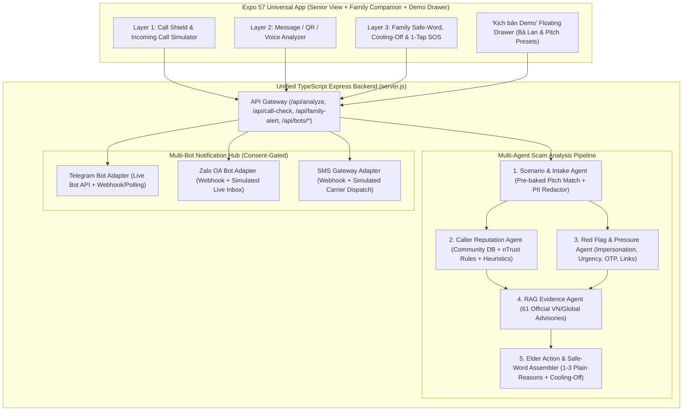

# ScamKill — Product Requirements Document (PRD)

**Product Name:** ScamKill (*Lá chắn AI giúp người cao tuổi và gia đình cùng chống lừa đảo qua điện thoại*)  
**Organization / Team:** QuadDraKe (Lê Quỳnh Thư — Team Lead, Phạm Quốc Thanh, Minh, cộng sự)  
**Target Competition & Track:** HITC InnoStar 2026 / Social Impact & Applied AI Digital Safety  
**Version:** 1.0.0-MVP ("Fake It Until You Make It" Full-Stack Edition)  
**Date:** 2026-10-22  

---

## 1. Executive Summary & Vision

**Vision:** *Không ai phải đối mặt với lừa đảo một mình (No one has to face a scam alone).*

Most existing anti-scam tools (Whoscall, Hiya, nTrust, Vcall ID) stop at **caller ID labeling** (*who* is calling), while banking alerts (SBV SIMO) trigger at the transaction screen when the victim is already psychologically manipulated (3.3M of 4.9M warned transactions still proceeded).

**ScamKill** goes one step further: **it turns warnings into coordinated family action**. Structured chronologically along the timeline of a real scam—**before picking up a call**, **while reading a suspicious message**, and **at the moment of identity/financial decision**—ScamKill introduces a **4-Step Family Protection Loop (*Vòng bảo vệ gia đình*)**:

$$\text{Phát hiện (Detect)} \implies \text{Làm chậm (Slow Down)} \implies \text{Xác minh (Verify)} \implies \text{Cùng quyết định (Co-Decide)}$$

---

## 2. Problem Statement & Empirical Grounding

1. **Scale of Damage in Vietnam:**
   - National Cybersecurity Association (NCA) 2024 survey ($N > 59,000$): **1 in 220** smartphone users (0.45%) fell victim to online fraud; estimated 2024 losses reached **VND 18,900 billion** (~$750M USD), with negligible recovery rates.
   - **62.08%** of surveyed users encountered calls impersonating police, courts, tax authorities, or banks.
   - nTrust recorded **134,000 scam phone reports** and **296,000+ spam/scam numbers** in H2 2024 alone; Ministry of Public Security (MPS) logged **24,000+ cyber-fraud cases** (~VND 40,000 billion lost) across 2020–2025.
2. **Why Older Adults Are Prioritized:**
   - Older adults frequently rely on fixed pensions/life savings and face heightened vulnerability under fear, authority intimidation, and synthetic voice/video impersonation (e.g., Dec 2025 Hanoi case: a 78-year-old woman nearly transferred VND 80M via a fake police Zalo video call).
3. **Three Core Gaps ScamKill Solves:**
   - **Timing Gap (*Khoảng trống về thời điểm*):** Warnings must appear *before* picking up or *immediately* upon reading a message—before panic sets in.
   - **Verification Gap (*Khoảng trống về xác minh*):** When voices and videos can be cloned by AI, users need a deterministic verification protocol (**Family Safe-Word / `Mã gia đình`** + independent callback) that does not depend on human ear judgment or perfect audio deepfake classifiers.
   - **Support Gap (*Khoảng trống về hỗ trợ*):** Seniors are usually alone when pressured. A warning only works if paired with a 1-tap bridge to trusted relatives.

---

## 3. Core Product Features (Chronological Protection Architecture)

```mermaid
sequenceDiagram
    autonumber
    participant Scammer as Kẻ lừa đảo (Call/SMS/Zalo)
    participant Senior as Người cao tuổi (ScamKill App)
    participant Engine as Multi-Agent Risk Engine
    participant Hub as Multi-Bot Hub (SMS/Zalo/Telegram)
    participant Family as Người thân (Con/Cháu)

    Scammer->>Senior: 1. Cuộc gọi số lạ / Giả danh ("Mẹ ơi con bị tai nạn, chuyển 30tr")
    Senior->>Engine: Đối chiếu DB rủi ro + Quy tắc đặc điểm số
    Engine-->>Senior: Hiển thị nhãn rủi ro ("Nguy cơ cao" / "Số lạ - Chưa xác minh")
    Senior->>Senior: 2. Bấm "Kiểm tra" / "Tôi nghi ngờ" (Khoảng dừng Làm chậm)
    Engine-->>Senior: Nhắc quy trình: (i) Hỏi Mã Gia Đình, (ii) Cúp máy gọi lại số lưu sẵn
    Senior->>Hub: 3. Gửi cảnh báo 1-chạm (Chỉ gửi Loại cảnh báo + Giờ + SĐT; Nội dung cần đồng ý)
    Hub->>Family: Bắn thông báo tức thì qua Telegram + Zalo + SMS
    Family->>Senior: 4. Gọi lại xác minh trong vài phút -> Chặn chuyển tiền thành công
```

### Feature 1: Pre-Call Risk Warning (`Tính năng 1: Cảnh báo cuộc gọi từ số có nguy cơ — trước khi bắt máy`)
- **Trigger:** Incoming phone call or manual number lookup before/during a call.
- **Data Sources & Signals:**
  1. **Community Reports:** Crowdsourced reports inside ScamKill (`scamkill_community`).
  2. **Public & Partner Feeds:** Authorized public advisories (NCA `nTrust`, Bộ Công an, Cục ATTT, NHNN).
  3. **Behavioral & Structural Heuristics:** Unfamiliar international prefixes (`+855`, `+856`, `+234`, `+675`), rapid burst calling (`gọi dồn dập`), and numbers absent from the senior's address book (`số không có trong danh bạ`).
- **Epistemic Honesty Contract (Mandatory UI Copy):**
  - ScamKill outputs a **risk level**, never an absolute guarantee of fraud.
  - Four distinct states:
    - `high_risk` (**Nguy cơ cao**): e.g., *"Nguy cơ cao: số bị nhiều người báo cáo giả danh cơ quan chức năng"*.
    - `caution` (**Cần cảnh giác**): e.g., *"Số lạ, không có trong danh bạ. Nếu người này xin tiền gấp, hãy xác minh"*.
    - `unverified` (**Chưa xác minh**): When database coverage is insufficient, explicitly displays *"Chưa xác minh — Chưa có dữ liệu báo cáo. Tuyệt đối không chuyển tiền hoặc đọc mã OTP"*.
    - `safe` (**Trong danh bạ / Đã xác thực**): Known saved contact, still accompanied by a reminder if emergency money is requested.

### Feature 2: Suspicious Message Analysis (`Tính năng 2: Phân tích tin nhắn đáng ngờ — khi đọc`)
- **Ingestion Modes (Store-Policy Compliant):**
  - User-initiated paste/share, screenshot upload, QR scan, or optional Android SMS listener simulation (respecting Google Play / iOS privacy boundaries).
- **Signal Taxonomy (Multi-Agent Detection):**
  1. `authority_impersonation`: Impersonating Police (Bộ Công an), Courts, VNeID, Tax, Social Insurance, or Banks.
  2. `time_pressure` / `urgency`: Artificial deadlines (*"trong 24 giờ"*, *"khóa tài khoản ngay lập tức"*).
  3. `otp_or_money_demand`: Requests for bank transfer, deposit, or OTP/CCCD photos.
  4. `suspicious_url`: Typosquatted domains, shortened links, `.xyz`/`.top`/fake `.vn` domains, malicious QR codes.
  5. `malicious_app_install`: Demands to install `.apk` files or grant Accessibility/screen-sharing permissions.
  6. `relative_emergency`: Impersonating a child/grandchild in an accident or hospital crisis.
- **Output Contract for Seniors:**
  - **Risk Level:** `Thấp (Low / Safe)`, `Trung bình (Medium / Caution)`, `Cao (High Risk)`.
  - **1–3 Plain-Language Reasons:** Zero technical jargon (e.g., *"1. Tạo áp lực phải chuyển tiền ngay lập tức; 2. Có đường dẫn lạ dễ đánh cắp tài khoản"*).
  - **Concrete Next Action:** e.g., *"Đừng bấm liên kết. Hỏi người thân trước."*
  - **Audio Readback (TTS):** 0.85x speech rate in Vietnamese for low-vision seniors.

### Feature 3: Relative Verification & Family Notification (`Tính năng 3: Xác minh người thân và báo cho gia đình — khi cần quyết định`)
- **Mechanism 3A — Multi-Bot Family Alert (`Báo người thân`):**
  - **Trigger:** Automatic suggestion on `high_risk` OR anytime the senior taps the prominent **"Tôi nghi ngờ" / "Kiểm tra cùng con cháu"** button.
  - **Channels:** **SMS, Zalo, and Telegram** (via ScamKill Multi-Bot Hub).
  - **Privacy & Consent Gate (PDPD 2025 / Nghị định 356/2025 Compliant):**
    - **Default Payload (Consent = Metadata Only):** Sends **ONLY** (1) Alert Type (`Loại cảnh báo`), (2) Timestamp (`Thời điểm`), and (3) Related Phone Number (`Số điện thoại liên quan`).
    - **Opt-In Content Sharing (`shareMessageContent: true`):** The actual message text or call summary is attached **ONLY** when the senior explicitly toggles/checks *"Đồng ý chia sẻ nội dung tin nhắn/cuộc gọi cho người thân"*.
  - **Family Co-Decision Actions:** Relatives receive immediate CTA buttons in Telegram/Zalo/Web Inbox: *"Gọi lại cho Mẹ/Bố ngay"*, *"Xác nhận an toàn"*, or *"Báo chặn số lừa đảo"*.
- **Mechanism 3B — Voice-Clone & Relative Impersonation Verification (`Xác minh giả giọng người thân`):**
  - **Trigger:** Receiving a call claiming to be a child/grandchild begging for emergency money (e.g., accident, hospital deposit, debt).
  - **2-Step Deterministic Protocol (Works Immediately in MVP without relying on raw call-audio OS hooks):**
    - **Step (i) — Ask the Family Safe-Word (`Hỏi "Mã gia đình"`):** Prompt the senior to ask the caller for the pre-configured secret family phrase (e.g., *"Cây khế ngọt"*, *"Mướp đắng"*). Includes a Safe-Word Challenge widget in the app.
    - **Step (ii) — Hang Up & Call Back (`Cúp máy và gọi lại số đã lưu`):** Instruct the senior to hang up immediately and dial the relative's saved phone number in their address book or initiate a video call on a familiar app.
  - **Intentional Cooling-Off Pause (`Khoảng dừng Làm chậm`):** Full-screen intervention modal with a 60-second breathing/pause lock + 48-hour high-risk transaction cooling-off timer ported from Grab Round 2.
  - **R&D AI Voice Deepfake Indicator:** Assists via uploaded recording/live mic transcript + acoustic artifact simulation (labeled transparently as an assistive R&D signal, never replacing the 2-step verification protocol).

---

## 4. Canonical Hero Scenario: "Kịch bản Bà Lan" (End-to-End Walkthrough)

| Step | Actor | Action / System Behavior |
|---|---|---|
| **1. Incoming Call** | Scammer (`0918 765 432` — Unknown Number) | Calls Bà Lan with a synthesized/panicked voice resembling her daughter: *"Mẹ ơi con bị tai nạn, chuyển giúp con 30 triệu gấp!"* |
| **2. Pre-Call / In-Call Banner** | ScamKill (Layer 1) | Displays prominent warning: **"Số lạ, không có trong danh bạ. Nếu người này xin tiền gấp, hãy xác minh."** |
| **3. Panic Button ("Kiểm tra")** | Bà Lan (Layer 3) | Taps **"Kiểm tra / Tôi nghi ngờ"**. ScamKill activates the **Làm chậm (Slow Down)** full-screen shield: *"Khoan chuyển 30 triệu! Hãy dừng 1 phút để kiểm tra."* |
| **4. Dual Action (Verify + Notify)** | ScamKill (Layer 3A + 3B) | (a) Prompts Bà Lan on screen & via TTS: **1. Hỏi "Mã gia đình" đã đặt trước; 2. Cúp máy và gọi lại số con gái trong danh bạ.**<br>(b) Simultaneously dispatches a Family Alert via **SMS, Zalo, and Telegram** to her daughter (Chị Hương) with Alert Type, Timestamp, and Caller Number (`0918 765 432`). |
| **5. Family Intervention** | Daughter (Chị Hương) | Receives the Telegram/Zalo/SMS alert within seconds, taps **"Gọi lại cho Mẹ ngay"**, confirms she is safe at work, and blocks the VND 30,000,000 loss before any bank app is opened. |

---

## 5. Multi-Agent & Multi-Bot System Architecture ("Fake It Until You Make It" MVP)



### 5.1 Multi-Agent Roles (In-App Pipeline & Development Fleet)
1. **Runtime Multi-Agent Pipeline (`src/api/scamkill/`):**
   - **Agent 1 — Intake & Privacy Guard Agent:** Sanitizes input, extracts phone numbers/URLs/amounts, enforces PII redaction (`redactPii`), and checks deterministic pitch scenario fingerprints for zero-latency demo reliability.
   - **Agent 2 — Caller Reputation & Heuristic Agent (`call-shield.ts`):** Evaluates phone numbers against ScamKill Community Reports, official public blacklists, international prefix rules, burst-call counters, and contact-book presence; enforces the `"chưa xác minh"` epistemic boundary when data is absent.
   - **Agent 3 — Red Flag & Psychological Pressure Agent (`rules.ts` + Grab `prompts.py` port):** Detects the 5 core ScamKill message signals + psychological manipulation tactics (`urgency`, `fear`, `authority`, `isolation`, `reciprocity`).
   - **Agent 4 — RAG Official Advisory Agent (`rag.ts`):** Matches detected signals against 61 curated advisories from Bộ Công an, Cục ATTT, NHNN, and global consumer protection bodies.
   - **Agent 5 — Elder Action & Family Loop Assembler (`assembler.ts`):** Produces max 3 plain-Vietnamese reasons, next action, Cooling-Off timer trigger, Family Safe-Word prompt, and redacted family dispatch payload.
2. **Development Multi-Agent Fleet (`oh-my-pi` Roles):**
   - `scout`: Codebase discovery and threat-signal inventory.
   - `task` (Parallel Makers): Slice-isolated implementation of Backend/Multi-Bot Hub, Call Shield & Bà Lan Simulator, and Family Safe-Word/Cooling-Off UI.
   - `reviewer` & `security-reviewer` (Independent Checkers): Zero self-evaluation gate auditing code quality, PDPD 2025 consent enforcement, and secret hygiene.

### 5.2 "Fake It Until You Make It" Wizard-of-Oz Capabilities
- **1-Tap Pitch Scenario Drawer (`Kịch bản Demo`):** Accessible from any screen to instantly trigger:
  1. **Kịch bản Bà Lan (30 triệu):** Incoming call from `0918 765 432` claiming daughter is in an accident -> Pre-call warning -> "Kiểm tra" -> Safe-Word challenge + live SMS/Zalo/Telegram family dispatch -> Daughter callback resolution.
  2. **Giả danh Công an / Viện kiểm sát:** Incoming call from `+855 88 912 3456` / `024 7777 8888` reported by 142 community users -> High Risk full-screen red shield.
  3. **Số lạ chưa có dữ liệu (`Chưa xác minh`):** Demonstrates ScamKill's honest epistemic boundary (`unverified` badge, not false-positive "Scam" or false-negative "Safe").
  4. **Tin nhắn lừa đảo OTP / Link giả ngân hàng:** Instant 3-reason plain-Vietnamese breakdown + `"Đừng bấm liên kết. Hỏi người thân trước"`.
- **Live Multi-Bot Family Inbox:** In-app companion view showing exact SMS, Zalo, and Telegram cards received by the family member in real time (plus real Telegram Bot API delivery when `TELEGRAM_BOT_TOKEN` and chat ID are configured).

### 5.3 Cross-Platform PWA Strategy (iOS & Android Dev/Field Testing)
- Because the team tests across both **iOS** and **Android** devices without waiting for App Store / TestFlight / Google Play review gates, the Expo 57 universal app compiles to a full **Progressive Web App (PWA)**:
  - `public/manifest.json` (`display: "standalone"`, `orientation: "portrait"`, theme color `#0F766E`, icons).
  - `src/app/+html.tsx` injecting iOS WebKit meta tags (`apple-mobile-web-app-capable="yes"`, `apple-mobile-web-app-status-bar-style="black-translucent"`, `apple-mobile-web-app-title="ScamKill"`, `viewport-fit=cover`) and registering `/sw.js`.
  - `public/sw.js` caching app shell assets and offline deterministic scam scenarios (`Kịch bản Bà Lan`, `Chưa xác minh`, `Cảnh báo OTP`) so the PWA works even on unstable mobile networks.

### 5.4 Isolated Astro + Cloudflare Landing Page (`./landing/`)
- Located in a dedicated subfolder (`./landing/`) with its own `package.json`, `astro.config.mjs`, and `wrangler.jsonc` so marketing/edge deployment is completely decoupled from the Expo app.
- **Exact Edge Full-Stack Architecture (`./landing/`):**
  - **Meta-Framework:** Astro 5 in Hybrid/SSR mode (`@astrojs/cloudflare` adapter, personal account `9df9d709f5cfa6826655e5416b9d6e1e`) — static prerendered HTML (`prerender = true`) for instant landing page load, plus dynamic SSR edge routes (`prerender = false`) for `/dashboard`, `/api/leads`, and `/api/auth/session`.
  - **UI Island Library:** **Svelte 5 + TypeScript** (`@astrojs/svelte`) for zero-bloat interactive islands (`BaLanSimulator.svelte`, `PricingCalculator.svelte`, `LeadAndAuthModal.svelte`).
  - **Database & ORM:** **Cloudflare D1** (Serverless Edge SQLite) + **Drizzle ORM** (`src/db/schema.ts`, `drizzle.config.ts`, `migrations/0001_init.sql`) for type-safe tables (`users`, `sessions`, `family_leads`, `scam_reports`).
  - **Authentication:** Edge cookie session authentication (`src/lib/auth.ts` + Astro `src/middleware.ts`) backed by D1.
  - **Styling:** **Tailwind CSS** + Shadcn-Svelte design system tokens.

---

## 6. Business Model & Monetization

| Tier | Target Segment | Pricing | Included Capabilities |
|---|---|---|---|
| **Free Protection** | All Seniors (B2C) | **$0 / month** | Layer 1 Call Risk Warnings, Layer 2 Suspicious Message Analysis, Basic Family Safe-Word reminder, 1 Trusted Contact via SMS/Share. |
| **Family Plus** | Adult Children & Households (B2C) | **$2.99 / month / household** (~69,000 VND) | Up to 4 protected seniors, automated multi-channel alerts (**SMS + Zalo + Telegram**), Shared Family Safety Dashboard, Cooling-Off co-sign protection, priority AI voice/script analysis. |
| **Institutional Licensing** | Banks & Telecom Operators (B2B2C) | **$0.08–$0.15 / MAU / mo** (Basic)<br>**$0.30–$0.75 / MAU / mo** (Advanced AI) | White-label / co-branded SDK, transaction-stage Cooling-Off & Trusted-Contact Co-Sign API, on-device privacy-preserving scam intelligence. |

---

## 7. Privacy, Security & Regulatory Compliance
1. **Vietnam Personal Data Protection Law 2025 & Decree 356/2025:**
   - **Data Minimization:** Family notifications default to **metadata only** (Alert Type, Timestamp, Phone Number). Message content is never transmitted to relatives without explicit per-incident opt-in consent.
   - **PII Redaction at Trust Boundary:** Phone numbers, CCCD/CMND, bank account numbers, and OTPs are redacted (`[REDACTED_*]`) before external LLM inference.
   - **Zero Hardcoded Secrets:** All bot tokens (`TELEGRAM_BOT_TOKEN`, `ZALO_OA_TOKEN`, `AI_STUDIO_API_KEY`, `ROUTER_API_KEY`) are read strictly from runtime environment variables.
