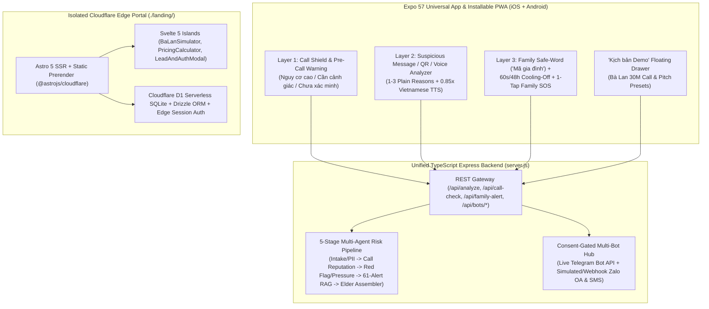

# 🛡️ ScamKill — AI Digital Safety Shield for Older Adults & Families

> **"Không ai phải đối mặt với lừa đảo một mình."**  
> *No one has to face a phone scam alone.*

**ScamKill** (by **QuadDraKe** — HITC InnoStar 2026) is a full-stack mobile/PWA & multi-bot protection system designed to help older adults recognize phone and message scams at the exact moment they are pressured to act, while bringing trusted family members into the loop with a single tap.

---

## 🌐 Live Deployments & Environments

| Surface | Stack | URL / Entry |
|---|---|---|
| **ScamKill Landing & Family Portal (`./landing/`)** | Astro 5 Hybrid/SSR (`@astrojs/cloudflare`) + Svelte 5 + Cloudflare D1 + Drizzle ORM + Tailwind 4 | `https://scamkill-landing.9ez.workers.dev` *(Cloudflare Workers + D1 Edge)* |
| **ScamKill Universal App & PWA (`./src/`)** | Expo SDK 57 (React Native 0.86 + Installable Web PWA) + Express 5 Multi-Bot API | `https://scamkill-pwa.9ez.workers.dev` *(Live PWA)* & Local (`http://localhost:8081`) |

---

## 🧠 Product Architecture: Chronological Protection & 4-Step Family Loop

Existing tools (Whoscall, Hiya, nTrust, Vcall ID) only label **who** is calling, while banking alerts trigger too late—when the victim is already psychologically manipulated. **ScamKill** turns warnings into coordinated family action across **3 chronological protection layers** and a **4-Step Family Protection Loop**:

$$\text{1. Phát hiện (Detect)} \implies \text{2. Làm chậm (Slow Down)} \implies \text{3. Xác minh (Verify)} \implies \text{4. Cùng quyết định (Co-Decide)}$$



### Core Features (Section 2.1 Specification)

1. **Feature 1 — Pre-Call Risk Warning (`Tính năng 1: Cảnh báo cuộc gọi từ số có nguy cơ — trước khi bắt máy`):**
   - Cross-references incoming callers against **ScamKill Community Reports**, authorized public advisories (**nTrust / Bộ Công an**), and behavioral heuristics (foreign prefixes `+855`/`+856`/`+234`, burst calling, not in contacts).
   - **Epistemic Honesty Contract:** Displays a calibrated risk state (`Nguy cơ cao`, `Cần cảnh giác`, `Trong danh bạ`, or **`Chưa xác minh`** when data is insufficient)—never claiming 100% certainty without evidence.
2. **Feature 2 — Suspicious Message Analysis (`Tính năng 2: Phân tích tin nhắn đáng ngờ — khi đọc`):**
   - Analyzes messages, screenshots, QR codes, and voice transcripts for authority impersonation, artificial urgency (*"trong 24 giờ"*), OTP/money demands, malicious links, and `.apk` install lures.
   - Outputs risk level (`Thấp`, `Trung bình`, `Cao`), **1–3 plain-language Vietnamese reasons**, `0.85x` TTS voice readback for seniors, and a concrete next action (*"Đừng bấm liên kết. Hỏi người thân trước"*).
3. **Feature 3 — Relative Verification & Family Notification (`Tính năng 3: Xác minh người thân & Báo cho gia đình`):**
   - **Mechanism 3A — Consent-Gated Multi-Bot Family Alert (`Báo người thân`):** One-tap `"Tôi nghi ngờ"` / `"Kiểm tra"` dispatches alerts via **SMS, Zalo, and Telegram**.
     - **PDPD 2025 Privacy Gate:** By default (`consentToShareContent = false`), notifications include **ONLY Alert Type, Timestamp, and Related Phone Number**. Message or call content is shared **only when the senior explicitly grants consent** (and is scrubbed via `redactPii`).
   - **Mechanism 3B — Voice-Clone Relative Verification (`Xác minh giả giọng người thân`):** Enforces a deterministic 2-step protocol that works today without relying on OS-restricted raw call audio:
     1. **Ask the Family Safe-Word (`Hỏi "Mã gia đình"`):** e.g., `"Cây khế ngọt"`.
     2. **Hang up and call back (`Cúp máy và gọi lại số đã lưu`):** Call the relative's saved contact number or video-call on a familiar app.
4. **Canonical "Kịch bản Bà Lan (30 triệu)" Demo Drawer:**
   - Tap **`🎬 Kịch bản Demo`** on any screen to simulate Bà Lan receiving an unknown call (`0918 765 432`) imitating her daughter (*"Mẹ ơi con bị tai nạn, chuyển giúp con 30 triệu"*), triggering the pre-call warning, the **Làm chậm** cooling-off pause, the **Mã gia đình** verification prompt, real-time **SMS/Zalo/Telegram** dispatch to her daughter (*Chị Hương*), and the daughter's callback intervention.

---

## 📂 Repository Structure

```text
QuadDrake/
├── src/
│   ├── api/
│   │   ├── scamkill/            # ScamKill Core Engine
│   │   │   ├── types.ts         # Zod 4 contracts (Call Shield, Multi-Bot Hub, Scenarios)
│   │   │   ├── call-shield.ts   # Feature 1: Caller reputation + heuristics + 'Chưa xác minh'
│   │   │   ├── scenarios.ts     # 5 deterministic pitch scenarios (incl. Kịch bản Bà Lan)
│   │   │   ├── multi-bot-hub.ts # Feature 3A: Consent-gated SMS/Zalo/Telegram dispatcher
│   │   │   └── client.ts        # Unified API + offline fallback client
│   │   ├── risk/                # Multi-agent rule + 61-alert RAG + LLM pipeline
│   │   ├── preprocess/          # Vietnamese PII redactor & entity extractor
│   │   └── privacy/             # Consent tokens, TTL sessions & audit log
│   ├── components/scamkill/     # Elderly UI Kit (56px touch targets, 18pt+ typography)
│   │   ├── IncomingCallModal.tsx
│   │   ├── CoolingOffModal.tsx
│   │   ├── SafeWordCard.tsx
│   │   ├── ScenarioDrawer.tsx
│   │   └── PwaInstallBanner.tsx
│   └── app/(tabs)/              # Expo Router screens (Call Shield, Analyzer, Family/Bots, Alerts, Lessons, Profile)
├── public/                      # PWA Manifest (manifest.json) & Service Worker (sw.js)
├── server.js                    # Unified Express 5 Backend & Multi-Bot Gateway
├── tests/                       # 26 Vitest suites (272 unit, component & integration tests)
├── landing/                     # Standalone Astro 5 + Cloudflare SSR + Svelte 5 + D1 + Drizzle Project
│   ├── src/
│   │   ├── components/          # Svelte 5 Islands (BaLanSimulator, PricingCalculator, LeadAndAuthModal)
│   │   ├── db/                  # Cloudflare D1 + Drizzle ORM schema & client
│   │   ├── lib/auth.ts          # Edge PBKDF2 + SHA-256 cookie session authentication
│   │   ├── middleware.ts        # Astro Edge auth middleware
│   │   └── pages/               # Prerendered index.astro + SSR /dashboard & /api/* routes
│   ├── migrations/0001_init.sql # D1 SQLite migration
│   ├── astro.config.mjs
│   └── wrangler.jsonc           # Cloudflare Workers + D1 binding config
├── PRD.md                       # Complete Product Requirements Document
└── CR-20261022-001.md           # Engineering Change Request Contract
```

---

## 🚀 Quickstart (Local Development)

### Prerequisites
- **Node.js** $\ge 22$
- **pnpm** (`corepack enable pnpm`)

### 1. Run the ScamKill Universal App (Expo PWA) + Multi-Bot Backend
```bash
# Install root dependencies
pnpm install

# Copy environment template
cp .env.example .env
# Optional: set AI_STUDIO_API_KEY, TELEGRAM_BOT_TOKEN, TELEGRAM_DEFAULT_CHAT_ID in .env

# Start both Express Backend (:3000) and Expo Web/Mobile (:8081)
pnpm run dev
# Or run separately:
pnpm run start:backend   # Express API on http://localhost:3000
pnpm run web             # Expo PWA on http://localhost:8081
```

### 2. Test as an Installable PWA on iOS & Android
1. Export or serve the web build (`npx expo export -p web` or `pnpm run web`).
2. **iOS (Safari):** Open the app URL $\rightarrow$ tap **Share (Chia sẻ)** $\rightarrow$ **Add to Home Screen (Thêm vào Màn hình chính)**. Launches full-screen standalone (`apple-mobile-web-app-capable`).
3. **Android (Chrome):** Open the app URL $\rightarrow$ tap **Install ScamKill App (Cài đặt ứng dụng)** in the top banner or browser menu.

### 3. Run the Astro 5 + Cloudflare Landing Page (`./landing/`)
```bash
pnpm --dir landing install

# Apply D1 SQLite schema locally
pnpm --dir landing run db:migrate:local

# Start Astro dev server on http://localhost:4321
pnpm --dir landing run dev
```

---

## ☁️ Cloudflare D1 & Edge Deployment (`./landing/`)

The `./landing/` project is pre-configured for **Cloudflare Workers + D1 Serverless SQLite** under account `9df9d709f5cfa6826655e5416b9d6e1e`:

```bash
cd landing

# 1. Create or verify the remote D1 database
pnpm exec wrangler d1 create scamkill-db

# 2. Apply Drizzle SQLite migrations to remote Cloudflare D1
pnpm run db:migrate:remote

# 3. Build and deploy to Cloudflare Workers Edge
pnpm run build
pnpm run deploy
```

---

## 🧪 Verification & Quality Gates

All pull requests to `main` must pass the automated CI gate (`.github/workflows/ci.yml`):

```bash
# 1. TypeScript strict check (0 errors)
pnpm run typecheck

# 2. Full Vitest suite (26 test files / 272 tests)
pnpm test

# 3. Astro + Cloudflare SSR build check
pnpm --dir landing run build
```

---

## 🔒 Git Workflow & `main` Branch Protection Policy

- **`main` is protected:** Direct pushes to `main` are restricted to the repository owner (`@ShayNeeo`).
- **Contributor Workflow (e.g., `@qminh-06`):**
  1. Create a feature branch from `main`:
     ```bash
     git checkout -b feat/<short-description>
     ```
  2. Run local verification before pushing:
     ```bash
     pnpm run typecheck && pnpm test && pnpm --dir landing run build
     ```
  3. Push the branch and open a **Pull Request** against `main`:
     ```bash
     git push -u origin feat/<short-description>
     gh pr create --fill
     ```
  4. All required status checks (`Typecheck + Test + Landing Build`) and PR review gates must pass before merging into `main`. Force-pushes and branch deletions on `main` are blocked.
